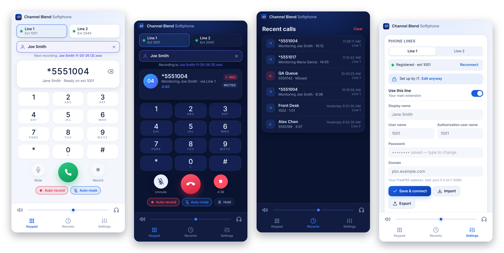
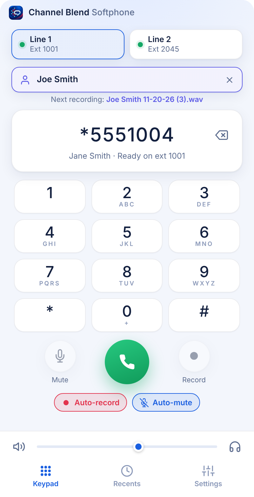
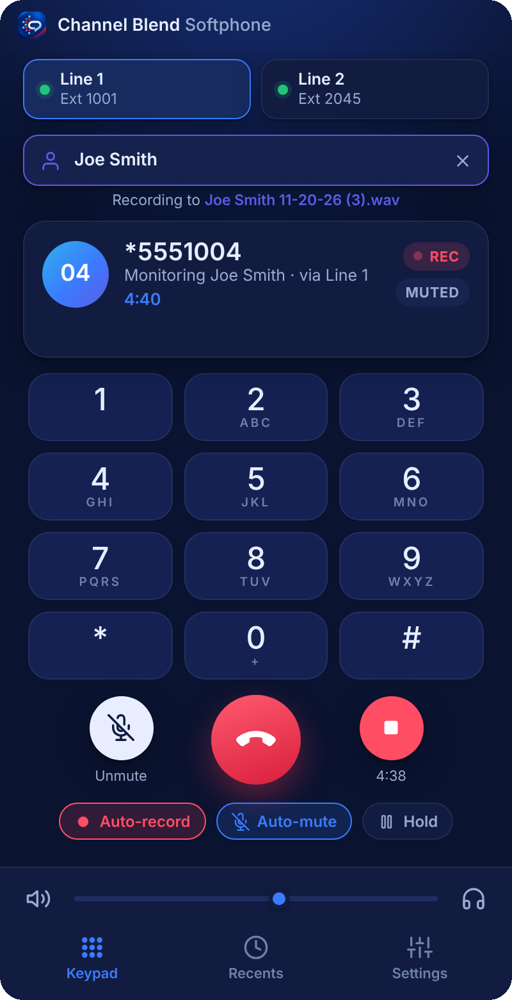
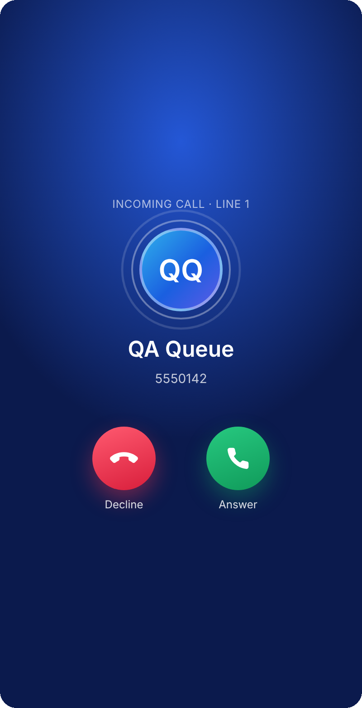
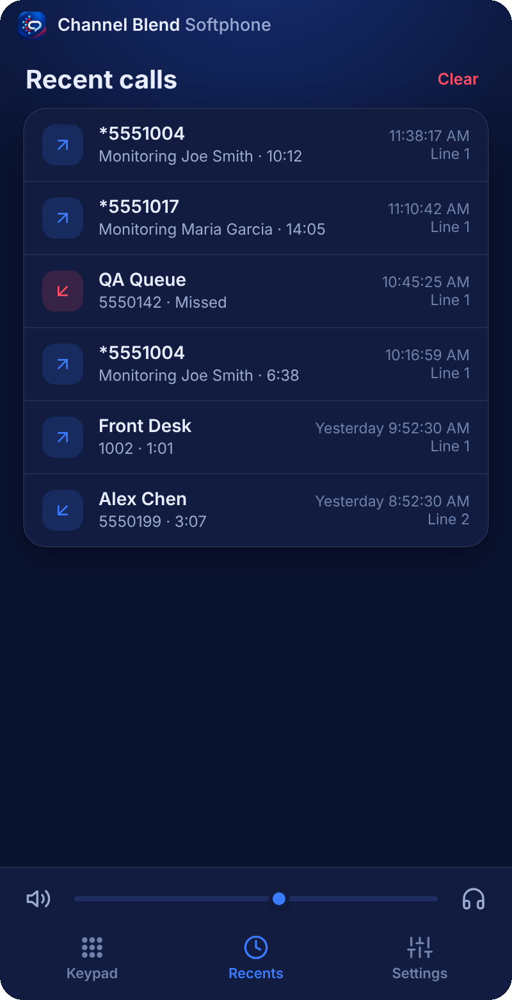
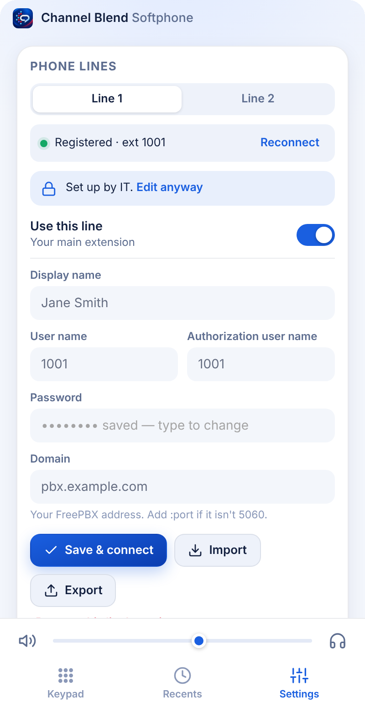
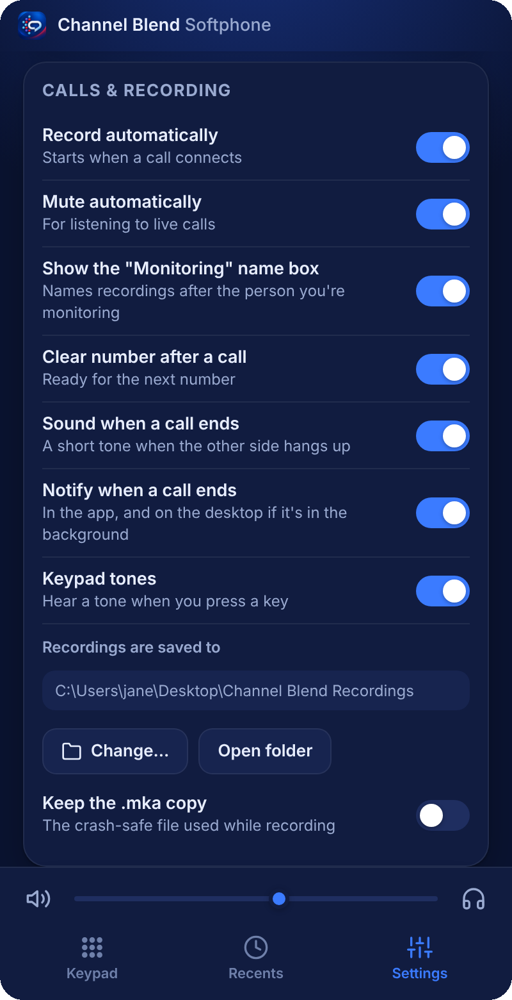
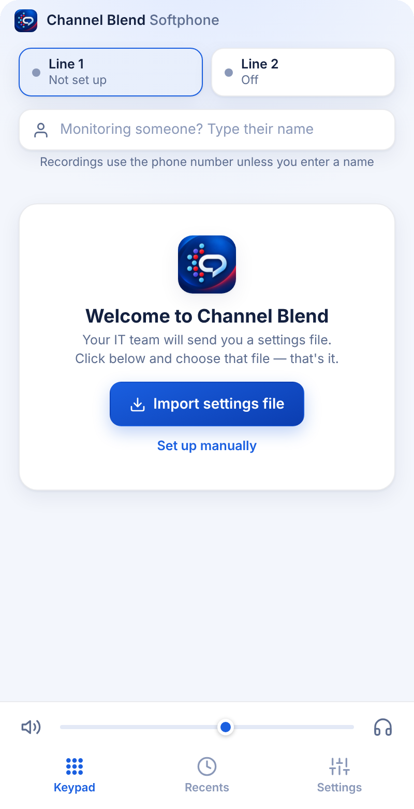
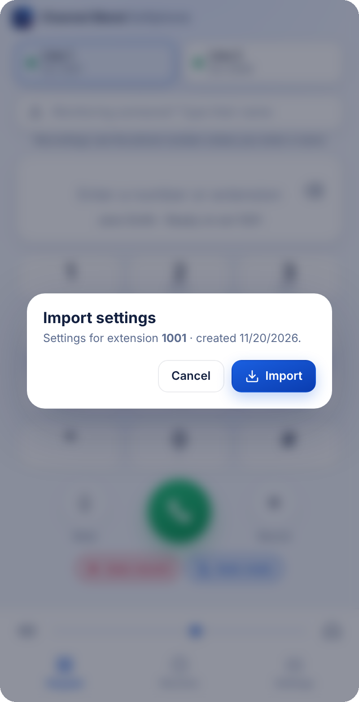
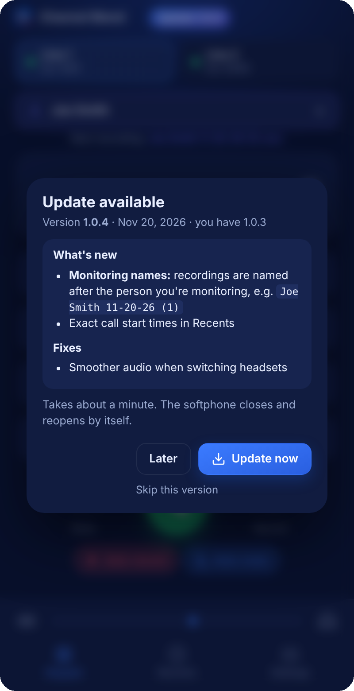

# Channel Blend Softphone

A modern, cross-platform SIP softphone for **Windows and macOS**, built for FreePBX / Asterisk.
It registers over plain **SIP/UDP** with the usual account details (user name, password,
authorization user name, domain, plus an optional display name). It needs no WebSocket gateway and
no changes on the PBX.

<p align="center">
  
</p>

It's designed for call centers and QA teams. It works without a microphone, records calls in a
crash-safe way, and lets IT hand out a ready-to-use configuration without ever sharing a password.

## Highlights

- **Two lines.** Line 1 for the user's own extension, Line 2 for a second or test extension. Click a line to choose which one dials.
- **Listen-only friendly.** No microphone required. The phone sends silence when there's no mic or the call is muted, and only opens the mic if the user unmutes.
- **Crash-safe call recording** with **auto-record** when a call connects.
- **One-click provisioning.** IT exports an encrypted settings file, and the employee imports it with a single click or a double-click on the file.
- **Modern UI** with light, dark and system themes. System is the default.
- **Call-ended sound and notification**, so the user always knows when the other side hung up.
- **Recordings named after the person being monitored**, e.g. `Joe Smith 11-18-26 (3).wav`.
- **Built-in update check** that shows what's new and lets the user choose *Update now*, *Later* or *Skip this version*.

## Screenshots

<table>
  <tr>
    <td align="center"><br><sub><b>Keypad</b> · monitoring name shows the next recording's file name</sub></td>
    <td align="center"><br><sub><b>In a call</b> · recording, auto-muted, monitoring</sub></td>
    <td align="center"><br><sub><b>Incoming call</b></sub></td>
  </tr>
  <tr>
    <td align="center"><br><sub><b>Recents</b> · start times to the second</sub></td>
    <td align="center"><br><sub><b>Phone lines</b> · set up by IT, password never shown</sub></td>
    <td align="center"><br><sub><b>Calls &amp; recording</b> settings</sub></td>
  </tr>
  <tr>
    <td align="center"><br><sub><b>First launch</b> · one-click import</sub></td>
    <td align="center"><br><sub><b>Importing a settings file</b></sub></td>
    <td align="center"><br><sub><b>Update available</b> · now, later or skip</sub></td>
  </tr>
</table>

<sub>Screenshots use demo data.</sub>

## Features

### Calling
- Dial pad with DTMF tones you can hear. The keyboard number keys, numpad, `*` and `#` work too.
- **Enter** dials, **Backspace** deletes, **Esc** clears. Pressing Call with an empty display recalls the last number dialed.
- During a call, keys send DTMF using RFC 2833 / RFC 4733, falling back to SIP INFO.
- The number clears automatically after each call, ready for the next one.
- Incoming calls get a full-screen answer/decline view, a ringtone and a desktop notification. **Enter** answers and **Esc** declines.
- Hold / resume.
- A second incoming call during an active call gets a busy signal.
- Recent calls list: click to fill in the number, double-click to call back.

### Audio
- Speaker volume slider (up to 150%) and a mute button on the main screen. Microphone and ring volume are in Settings.
- **Auto-mute** when a call connects. Ideal for supervisors listening to live calls; the mic is never opened.
- A quick headset button switches speaker or microphone without opening Settings. The full device lists are in Settings → Audio, and the app copes with devices being unplugged and plugged back in.
- A short tone and an in-app notice when a call ends, plus a desktop notification if the app is in the background. Each can be turned on or off.

### Recording
- Manual record button, plus an **Auto-record** toggle on the main screen.
- Recordings are saved to `Desktop/Channel Blend Recordings` by default. The folder can be changed in Settings.
- **Crash-safe by design.** While recording, audio streams into a Matroska audio file (`.mka`) that is flushed to disk every half second. The file is valid and playable at any moment, the same approach OBS uses with `.mkv`.
- When the recording stops, it's converted to a standard **.wav** file (8 kHz, 16-bit mono) and the `.mka` is removed. A setting keeps the `.mka` copy if you want it.
- If the app or computer crashes mid-recording, the next launch finds the unfinished file and converts it to `.wav` automatically, then tells the user. At most about half a second is lost.

### Monitoring names (for QA)
- Type the name of the person you're monitoring in the **Monitoring** box on the main screen.
- Each recording is then named `<Name> MM-DD-YY (n)`, for example `Joe Smith 11-18-26 (1)`, `(2)`, `(3)`.
- The number continues for the same person on the same day. It still continues after monitoring someone else or restarting the app, because it's worked out from the files already in the recordings folder.
- Recently used names appear as suggestions, so they're spelled the same each time. Capitalization doesn't break the sequence: `joe smith` continues `Joe Smith`.
- The line under the box shows the exact name of the next recording.
- Clear the box to go back to phone-number names. The box can be hidden in Settings.

### Updates
- The app checks the GitHub repository's latest Release when it opens, then every 6 hours. You can also click **Settings → About → Check for updates**.
- When a newer version exists, it shows the release notes with three choices:
  - **Update now:** Windows downloads, verifies and installs the update quietly, then reopens the app. On Mac the `.dmg` opens for dragging into Applications.
  - **Later:** asks again in 24 hours. Meanwhile an *Update* badge in the title bar opens the window again.
  - **Skip this version:** doesn't ask again until the next version.
- It never interrupts a call. An update found during a call is shown after the call ends.
- The repository is set in `package.json` as `"updateRepo"`. Update checks need the repository to be **public**, because GitHub doesn't show private releases without a login. The code is safe to make public because the company key isn't in it.

### Provisioning (for IT)
1. On your own machine, set the employee's extension up on **Line 2**. Your own extension stays on Line 1.
2. Click **Save & connect** and confirm the line registers (the dot turns green). Place a test call if you like.
3. Click **Export**. You can optionally add a PIN, which you share with the employee separately. Save the `.cbprov` file.
4. Send the file to the employee. They can do any one of these:
   - double-click it (the installer associates `.cbprov` files with the app),
   - click **Import settings file** on the welcome screen, or
   - drag it onto the app window.

   The extension registers immediately.

The password inside a `.cbprov` file is encrypted with AES-256-GCM. Once the file is imported:
- the password is stored using the OS keychain (Windows DPAPI / macOS Keychain),
- the UI never displays it,
- the line is marked **Set up by IT** with its fields locked. An **Edit anyway** link (with a warning) unlocks them.

> Anyone with a copy of your company's build can import a `.cbprov` file, so treat the files like a
> key and use the optional PIN for extra protection. See *The company key* below.

### Networking
- SIP over UDP with digest authentication (MD5, with SHA-256 if the server offers it) and a separate authorization user name.
- Works for remote staff behind home routers. It uses `rport` with automatic Contact correction, sends CRLF keep-alives every 30 s, and re-registers automatically when the network changes.
- Registration refreshes before expiry and honors `Min-Expires`. DNS SRV (`_sip._udp`) lookup is used when no port is given.
- Symmetric RTP: the phone sends media continuously and latches onto the address the PBX actually sends from.
- The local RTP port range is configurable. The default is 5000–36385.
- Codecs: G.711 µ-law (PCMU) and A-law (PCMA).

## Getting started

### Requirements
- [Node.js](https://nodejs.org) 20 or newer (only needed to build).
- A FreePBX / Asterisk extension with `ulaw` and/or `alaw` allowed.

### Run from source
```bash
npm install
npm start
```
On Windows you can also double-click **RUN-DEV.bat**.

### Build installers
| Platform | Command | Output |
|---|---|---|
| Windows | `npm run dist:win`, or double-click **BUILD-WINDOWS.bat** | `dist/ChannelBlendSoftphone-Setup-<version>.exe` |
| macOS (run on a Mac) | `npm run dist:mac` | `dist/ChannelBlendSoftphone-<version>.dmg` (universal) |

**GitHub Actions:** the workflow in `ci/build.yml` builds both installers. Copy it to
`.github/workflows/build.yml` and add the `CB_PROVISIONING_KEY` secret (see below), then run **Build installers** from the Actions tab or push a tag such as
`v1.0.1`. The installers are attached to the run as artifacts.

The builds are unsigned by default. Windows SmartScreen shows *More info → Run anyway*, and macOS
needs *right-click → Open* the first time. Add code-signing certificates to remove those prompts.

### The company key (do this once)
Settings files (`.cbprov`) are locked with a company key. The key is **not** stored in the code or on
GitHub: it lives in `src/main/config/provisioning.key`, which `.gitignore` keeps out of the repository.

1. Run `npm run make-key` (BUILD-WINDOWS.bat does this automatically the first time). It creates the key file and prints its value.
2. Back up the key, for example in your password manager. If it's lost, every settings file has to be exported again.
3. On GitHub go to **Settings → Secrets and variables → Actions → New repository secret**, name it
   `CB_PROVISIONING_KEY`, and paste the same value. The workflow writes it into the build, so cloud-built
   and locally built copies can open each other's files.

Without a key file the app uses a public test key, and the Export window shows a **Test build** warning.

### Tests
```bash
npm test
```
This starts a fake PBX on localhost and checks registration, outgoing and incoming calls, DTMF,
listen-only audio, auto-mute, auto-record, WAV conversion and settings import/export. It also runs a
smoke test of the Electron main process.

## Recommended FreePBX settings for remote users
For PJSIP extensions:
- **NAT:** Yes (force_rport, rewrite_contact, rtp_symmetric)
- **Direct Media:** No
- **Codecs:** include `ulaw` and/or `alaw`

## Project layout
```
src/main/main.js          Electron main process: window, IPC, app:// protocol, notifications
src/main/engine.js        Lines, active call, recording, recents (no Electron dependency)
src/main/sip/             SIP parser, digest auth, SDP, user agent (REGISTER/INVITE/BYE/CANCEL/re-INVITE)
src/main/media/           RTP session, G.711 codecs, jitter buffer, RFC 2833 DTMF
src/main/recording/       Streaming .mka writer/reader, .wav conversion, crash recovery
src/main/config/          Settings store, .cbprov provisioning
src/renderer/             UI (HTML/CSS/JS), audio worklets, icons
test/                     Fake-PBX end-to-end test, main-process smoke test
build/                    App icons, macOS entitlements
ci/                       GitHub Actions workflow (copy)
docs/screenshots/         README screenshots
```

Logs, with SIP traces and digest responses masked, are written to the app's data folder. You can open them from
**Settings → About → Show log file**.

## Roadmap
- Blind and attended transfer
- Conference and call waiting
- Wideband codecs (G.722 / Opus)
- TLS / SRTP
- Fully silent updates on macOS (needs an Apple Developer certificate)
